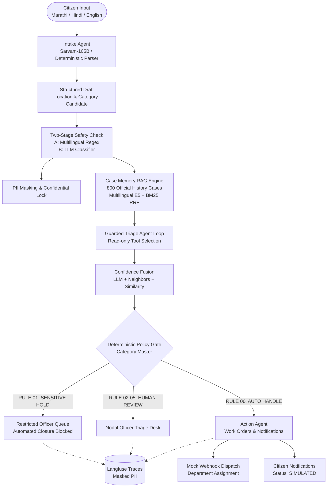

# Shikayat Sarathi — Intelligent Grievance Redressal Multi-Agent System
**HackFusion 4.0 Prototype** | Nanded District Administration, Maharashtra

[](https://www.python.org/)
[](https://fastapi.tiangolo.com/)
[]()
[]()

---

## 1. System Architecture



---

## 2. Core Invariants & Safety Guarantees

1. **Category Master is the Sole Source of Truth:**
   All policy flags (`sensitive`, `identity_hiding`, `auto_resolution_allowed`, `sla_days`) come directly from `data/grievance_category_master.csv` at runtime. No hard-coded category IDs exist in the decision path.
2. **Zero Sensitive Leakage:**
   Sensitive complaints (women safety, child protection, live sparking wires, imminent physical threats, confidential health records) are strictly locked to `SENSITIVE_HOLD`. Automated handling or closure is permanently disabled.
3. **LLM Proposes, Code Disposes:**
   The language model outputs unstructured and candidate drafts; pure deterministic Python code enforces policy gates, routing, and state transitions.
4. **Zero Silent Merges:**
   Incident clustering identifies duplicate complaints in the same locality and time window as suggested groupings. Every complaint maintains its own independent reference number, status history, and citizen notifications.
5. **No Fabricated Confidence or Transcripts:**
   When upstream models do not provide confidence, `confidence` is stored as `null` and the case routes to `HUMAN_REVIEW`. Audio transcription never uses hard-coded canned text.
6. **No PII Leaks to Traces:**
   All spans sent to Langfuse undergo strict recursive redaction: 12-digit Aadhaar numbers, phone numbers, email addresses, personal names, and exact street numbers are sanitized.

---

## 3. Environment Variables Configuration

Create a `.env` file in the prototype root (copy from `.env.example`):

| Variable | Description | Default |
|---|---|---|
| `SARVAM_API_KEY` | Subscription key for Sarvam AI (Chat & Saaras STT) | `""` (mock fallback active) |
| `LANGFUSE_PUBLIC_KEY` | Langfuse Project Public Key | `""` (tracing disabled if empty) |
| `LANGFUSE_SECRET_KEY` | Langfuse Project Secret Key | `""` |
| `LANGFUSE_HOST` | Langfuse host URL | `https://cloud.langfuse.com` |
| `LANGFUSE_PROJECT_ID` | Langfuse Project ID for trace link generation | `""` |
| `DEMO_OFFICER_KEY` | API Key for Officer endpoints | `officer-demo-key` |
| `DEMO_CITIZEN_KEY` | API Key for Citizen endpoints | `citizen-demo-key` |
| `AUTO_HANDLE_CONFIDENCE_THRESHOLD` | Threshold for routine auto-handling | `0.75` |
| `CLUSTER_SIMILARITY_THRESHOLD` | Threshold for duplicate grouping | `0.82` |
| `CLUSTER_WINDOW_DAYS` | Window for incident duplicate search | `15` |
| `ENABLE_DEV_BACKDATE` | Enable `/api/dev/backdate` for SLA testing | `False` |
| `SLA_SCAN_INTERVAL_MINUTES` | Frequency of APScheduler SLA evaluations | `5` |
| `EMBEDDING_MODEL` | Hugging Face model for multilingual embeddings | `intfloat/multilingual-e5-small` |
| `EMBEDDING_ALLOW_DOWNLOAD` | Download the model on first run (`false` = BM25 only unless already cached) | `true` |
| `EMBED_WEAK_SIM` / `EMBED_STRONG_SIM` | Cosine thresholds for retrieval quality. **Uncalibrated defaults**: run `python scripts/calibrate_retrieval.py` | `0.78` / `0.84` |
| `SARVAM_CHAT_MODEL` / `SARVAM_STT_MODEL` | Verified against docs.sarvam.ai | `sarvam-105b` / `saaras:v3` |
| `AGENT_LOOP_ENABLED` | Guarded agent loop (needs a Sarvam key) | `true` |
| `SLA_ALERT_THRESHOLD` | Breach probability that raises a pre-emptive alert | `0.75` |
| `TRACE_PUBLIC_FOR_SENSITIVE` | Mark sensitive traces public (demo only) | `false` |

### How to Enable Public Langfuse Dashboard for Judges
1. Create a free account at [cloud.langfuse.com](https://cloud.langfuse.com) and create a project.
2. In Project Settings -> API Keys, copy Public Key and Secret Key into `.env`.
3. Also set `LANGFUSE_PROJECT_ID` (shown in the project URL) and `LANGFUSE_HOST`.
4. Nothing else to click: after each policy decision the app marks that grievance's trace **public** through the SDK, and the API returns `public_trace_link` (opens without a Langfuse login) plus `trace_visibility`.
5. **Sensitive and identity-masked cases are deliberately not public**: `public_trace_link` is `null`, `trace_visibility` is `restricted`, and only project members can open them. For the demo video you can set `TRACE_PUBLIC_FOR_SENSITIVE=true`; their payloads are already redacted and the complaint text is replaced by a length stub.
6. `GET /api/health` shows `langfuse_enabled`, `langfuse_errors` and `langfuse_last_error` so a broken setup is visible instead of silent.

---

## 4. API Endpoints Reference

### Citizen & Conversational Intake
- `POST /api/intake/chat` — Multilingual chat turn (Marathi, Hindi, English).
- `POST /api/intake/confirm` — Citizen confirmation of structured draft -> triggers Orchestrator.
- `POST /api/intake/voice` — Multilingual voice complaint transcription (returns HTTP 503 if STT is unavailable; never returns fake transcripts).
- `POST /api/grievances/{ref_no}/confirm-resolution` — Citizen confirmation of successful resolution.
- `POST /api/grievances/{ref_no}/dispute` — Citizen dispute loop (reopens grievance with elevated priority).

### Officer Queue & Governance
- `GET /api/grievances` — List grievances with PII masking for sensitive cases.
- `GET /api/grievances/{ref_no}` — Full dossier with precedent evidence, status history, and work orders.
- `PATCH /api/grievances/{ref_no}/status` — Status transition with role-based invariant check.
- `PATCH /api/grievances/{ref_no}/assign` — Department and officer reassignment.
- `GET /api/incidents` — Suggested and confirmed duplicate incident clusters.
- `POST /api/incidents/members/{id}/confirm` — Officer confirmation of duplicate grouping.
- `POST /api/incidents/members/{id}/reject` — Officer rejection of duplicate grouping.

### Work Orders & Webhooks
- `POST /api/work-orders` — Create work order.
- `GET /api/work-orders` — List dispatched work orders.
- `POST /api/mock-webhooks/{mock_webhook_id}` — Simulated external department webhook receiver.

### SLA Intelligence & Analytics
- `GET /api/sla/alerts` — Active pre-emptive SLA breach alerts.
- `POST /api/sla/scan` — Manually trigger background SLA breach evaluation.
- `GET /api/analytics/bottlenecks` — Department backlog and recurrence hotspots.

### System Health
- `GET /api/health` — Subsystem statuses (LLM mode, STT mode, Langfuse status, embedding backend).

---

## 5. Running the Prototype & Tests

### Installation
Use Python 3.12. Netlify reads the version from `runtime.txt` before installing `requirements.txt`. The pinned `pydantic-core` release has a Linux wheel for Python 3.12, so pip does not need to compile it with Rust.

```bash
python -m venv venv
venv\Scripts\activate   # Windows
pip install -r requirements.txt
```

### Running the Server
```bash
uvicorn app.main:app --port 8000 --reload
```
Access the web portal at [http://localhost:8000](http://localhost:8000).

### Netlify Deployment
Netlify publishes the static frontend from `app/static`. This configuration does not run the FastAPI server, so features that call `/api` require a separately configured backend.

### Running Test Suite
```bash
pytest tests/ -v
```
**Current Test Status: 45 passed (100% pass rate).**

### Seeding Demo Data via API
```bash
python scripts/seed_demo.py
```

---

## 6. Honest Limitations & Operational Boundaries
- **Offline Fallback:** Without the embedding model the system falls back to BM25 (reported as `retrieval_mode: "bm25"`). Without a Sarvam key it runs the deterministic pipeline: keyword intake, regex-only safety stage (LLM stage B reported as `not_configured`), no agent loop. Every response says which mode ran; nothing pretends.
- **Safety nets are layered, not perfect:** the regex stage is the offline net, the LLM stage B is the second net when a key is set (and a configured-but-failing stage B sends the case to a human), and a retrieval-proximity check is only a weak backstop. No keyword list can promise zero leakage on unseen text.
- **Agent loop:** the model chooses among read-only tools and proposes; code validates and the deterministic gate decides. Sarvam tool-calling with `tool` role messages follows the OpenAI-style schema in its docs but has not been exercised against a live key here; if it is rejected the loop falls back to the deterministic pipeline and the trace says so.
- **SLA prediction** uses 17 to 21 resolved examples per category from synthetic data; treat the probabilities as a demo of the method.
- **Multilingual Bridge:** Since the official 800-case history is English-only, vernacular complaints are bridged through the multilingual normalizer before vector/lexical retrieval.
- **Simulated Notification Channels:** Email and WhatsApp notifications are simulated with status `SIMULATED` to avoid transmitting synthetic data to real external mail/phone gateways.
